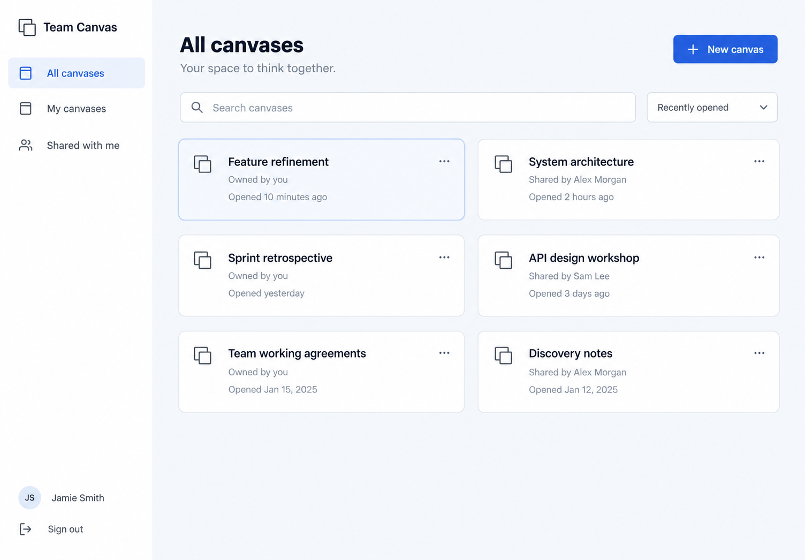

# User dashboard and Keycloak sign-in

Historical backlog. The [company-readiness backlog](company-readiness/README.md) supersedes readiness-based poker and authorship requirements.

Status: In progress — implementation is present; runtime acceptance/release checks remain pending. See [validation evidence](validation.md).

## Goal

Give every authenticated Team Canvas user a clean starting page for their own canvases and canvases they have joined through invitation links, with intuitive navigation between the dashboard and editor.

## Agreed decisions

- Require company Keycloak sign-in for all application data and collaboration; create a local account on first successful login.
- Provide a development-only Keycloak setup and two test accounts for local/WLAN use. Production connects to the company-managed realm/client.
- Use English throughout the application and Tailwind for application styling.
- Use the approved sidebar and compact-card dashboard design. Include All canvases, My canvases, Shared with me, name search, and Recently opened / Name sorting.
- Include create, open, owner-only rename, and owner sharing. Add shared canvases only after the recipient signs in and accepts an invitation link.
- Keep membership persistent across devices and separate it from expiring sessions; opening another tab must not invalidate existing sessions.
- Generate independent invitation links; new links do not invalidate existing ones. Retain host revocation behavior.
- Protect pending edits during navigation and preserve the fixed poker roster. Every member must still be ready before private contributions are published.
- Start with fresh user-owned canvases. Legacy guest access/ownership claiming is out of scope, and no automatic destructive data reset is allowed.

Out of scope: chat bots, archive/delete workflows, individual permission-management UI, a company user directory, direct user invitations, canvas thumbnails, horizontal backend scaling, and migrating legacy guest identities.

## Approved design

The concept is a visual reference; the displayed users, canvases, and dates are examples, not seed data. Use white surfaces, pale neutral backgrounds, slate typography, restrained blue accents, and compact metadata cards. Keep the main New canvas action easy to find. Sidebar account controls contain the display name and Sign out.

On mobile, collapse the sidebar into a menu and use one card column. In the editor, use a compact Back to canvases link and searchable canvas switcher. Include accessible loading, empty, retry, dialog, and focus states. Do not render private scene previews on the dashboard.

## Tickets and dependencies

| Ticket | Deliverable | Depends on | Status |
| --- | --- | --- | --- |
| [TC-001](TC-001-persistent-accounts-and-memberships.md) | Persist accounts, canvas ownership, memberships, and independent sessions | — | In progress |
| [TC-002](TC-002-development-keycloak.md) | Provide Keycloak sign-in for local development and WLAN testing | — | In progress |
| [TC-003](TC-003-keycloak-authentication-and-sessions.md) | Require Keycloak login and provision user accounts | TC-001, TC-002 | In progress |
| [TC-004](TC-004-canvas-dashboard-api.md) | List, create, and rename authorized canvases | TC-001, TC-003 | In progress |
| [TC-005](TC-005-invitation-api.md) | Share canvases through authenticated invitation acceptance | TC-001, TC-003 | In progress |
| [TC-006](TC-006-tailwind-ui-and-routing.md) | Build the English application shell with Tailwind and routed screens | — | In progress |
| [TC-007](TC-007-user-dashboard.md) | Implement the personal canvas dashboard | TC-003, TC-004, TC-006 | In progress |
| [TC-008](TC-008-sharing-and-invitation-ui.md) | Add share dialogs and the invitation sign-in journey | TC-003, TC-005, TC-006, TC-007 | In progress |
| [TC-009](TC-009-canvas-navigation-and-draft-protection.md) | Add intuitive canvas switching without losing work or poker membership | TC-003, TC-004, TC-006, TC-007, TC-008 | In progress |
| [TC-010](TC-010-release-validation-and-documentation.md) | Validate and document the authenticated dashboard release | TC-001, TC-002, TC-003, TC-004, TC-005, TC-006, TC-007, TC-008, TC-009 | In progress |

Suggested development sequence:

1. Foundation: TC-001 (data model), TC-002 (development identity provider), and TC-006 (UI foundation).
2. Authentication: TC-003.
3. Authorized APIs: TC-004 and TC-005.
4. User flows: TC-007, TC-008, and TC-009 in order.
5. Release review: TC-010.

Independent foundations may progress separately, but user-facing flows must be validated together. Dependencies describe delivery order, not a requirement to defer writing regression tests until the final ticket.

## Working process

Use **Todo → In progress → In review → Done**. Update both the ticket and this index when changing status. Check off implementation and acceptance items only when completed, and record validation evidence under Completion notes. If blocked, record the blocker and the next action instead of marking the ticket done.

A ticket is ready for review when its behavior is implemented, relevant tests/checks pass, documentation is updated where needed, and any dependent interfaces are integrated. Record screenshots for visual changes. Never include credentials, tokens, invitation secrets, or private canvas contents in evidence.

Completing these tickets does not itself authorize publishing or deploying the application. Use the normal release process after review.

## Technical references

- [Existing architecture](../docs/architecture.md)
- [Company deployment](../deploy/kubernetes/README.md)
- [Tailwind with Vite](https://tailwindcss.com/docs/installation/using-vite)
- [Tailwind Preflight and reset isolation](https://tailwindcss.com/docs/preflight)
- [Quarkus OIDC authorization-code flow](https://quarkus.io/guides/security-oidc-code-flow-authentication/)
- [Keycloak hostname and backchannel configuration](https://www.keycloak.org/server/hostname)
- [React Router navigation blocking](https://reactrouter.com/how-to/navigation-blocking)
